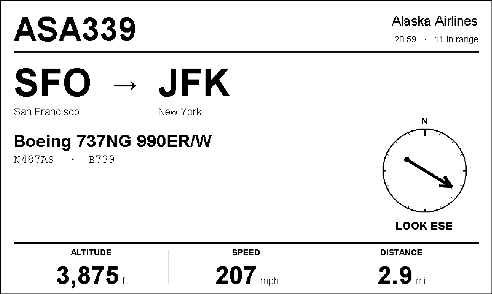
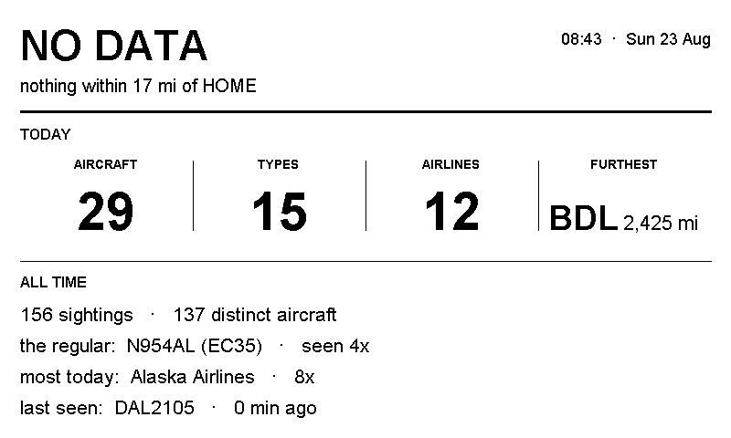

# Flight Tracker — what's flying overhead, on an e-ink picture frame

A Raspberry Pi drives a 7.5" e-ink panel in a picture frame on the wall. The panel shows the aircraft overhead right now: the airline, flight number, route and aircraft type, plus a compass arrow that says which way to look out the window.

It answers a question that comes up at home whenever a plane goes over: where is that one going? I built it with Claude Code as a personal project, to learn by shipping something real that someone uses every day.



---

## The product decisions

**1. Working the same day beat the best possible data.** The purist setup is a $30 radio receiver that picks up aircraft broadcasts directly. I started with free community APIs instead ([adsb.lol](https://adsb.lol) for live positions, [adsbdb](https://www.adsbdb.com) for airlines, routes and airframes), which need no API key, no account and no extra hardware. The receiver is documented as the v2 upgrade. I rejected OpenSky because it now requires OAuth credentials and caps anonymous use at 400 calls a day.

**2. Test the screen at full size before buying any hardware.** `mockup.py` prints the card at the panel's exact physical size, with a 100 mm ruler to check the print scale. I taped it where the frame would hang and read it from the sofa before spending $57 on the panel. If the flight number isn't readable from across the room, no hardware will fix that, so you change the layout instead.

**3. Design around the medium's constraints.** E-ink refreshes with a visible full-screen flash, so the logic is built around not redrawing:
- **Stickiness.** When two planes are at similar distances, a naive "show the nearest" swaps the screen on every poll. A plane holds the screen for 90 seconds unless a rival is more than 3 nm closer.
- **Redraw only on meaningful change.** The screen redraws only when a rounded value changes: altitude to the nearest 500 ft, distance to the nearest mile. Every 20th refresh is a full clear to stop ghosting.
- **The preview never lies.** Rendering happens in one-bit mode, so the PNG preview is pixel-identical to what the panel shows, and aircraft photos are dithered to read on black and white.

**4. Give the empty state a job.** When the sky is quiet, the panel shows the day's tally and all-time highlights from a local logbook instead of a blank screen.



**5. Be polite to free services.** Lookups are cached on disk: routes for 24 hours, airframes for 30 days, photos indefinitely.

## The biggest thing I learned: measure the data before trusting it

Look at the card above: an Alaska Airlines 737 "from SFO to JFK", at 3,875 ft, three miles from a house nowhere near either airport. That can't be right.

Route databases look a flight up by its flight number alone, and airlines reuse flight numbers across seasons and city pairs. The answers come back looking authoritative and are often about a different flight. I measured it against the live sky: the route source was **right for 1 of the 5 aircraft** it returned an answer for.

That led to a three-part fix, built on a later version of the device. It isn't in this repo yet:
1. **Plausibility checks.** The aircraft's position and both airports' coordinates are known, so the claimed route can be tested. Below 5,000 ft a plane is within about 15 nm of a runway, so if it's far from both airports, it isn't flying that route. A failing route shows as "route unconfirmed" with no progress bar, because a percentage from the wrong route is worse than none.
2. **Reversal correction.** Many wrong answers had the right airports in the wrong order. A plane doesn't descend into the airport it just left, so a failing route is retried reversed.
3. **A better source.** adsb.lol's route API lists every leg of an aircraft's day, so the code can pick the leg the plane could actually be on. It scored **5 of 5** where the first source scored 1 of 5.

The lesson I'd apply anywhere: when data looks authoritative, test it against something you can observe before it reaches the user.

## How it works

| File | What it does |
|---|---|
| `tracker.py` | Fetches positions from adsb.lol, filters them, picks the plane, looks up its route and airframe, and flags anything notable (emergency squawks, military, A380s and 747s). `--fields` reports which optional fields your sky actually delivers. |
| `geo.py` | Great-circle maths: progress along the route, time to landing, head- or tailwind. |
| `logbook.py` | A SQLite record of every aircraft seen: visit counts, first sightings, daily tallies, furthest destination. |
| `render.py` | Draws the 800×480 card in one-bit mode, exactly what the panel shows. |
| `display.py` | Pushes the image to the Waveshare panel, or writes `preview.png` when no panel is attached. |
| `run.py` | The main loop, the refresh rules, and the `--demo` / `--serve` / `--once` modes, plus a web preview you can open on a phone. |
| `mockup.py` | The actual-size printable mock-up described in decision 2. |
| `config.json` | Every setting. The coordinates are a placeholder (Chicago O'Hare airport); put in your own. |
| `flighttracker.service` | systemd unit so it starts on boot. |

## Try it

```bash
git clone https://github.com/yli623/flight-tracker.git && cd flight-tracker
python3 -m venv .venv && source .venv/bin/activate && pip install Pillow
# set home.lat / home.lon in config.json
python3 run.py --demo     # sample data, no internet needed
python3 tracker.py        # what is overhead right now, as text
python3 run.py --serve    # live loop, with a preview at http://localhost:8080
```

Building the physical frame takes a Raspberry Pi 4 and a Waveshare 7.5" e-Paper HAT (about $57). The full walkthrough is in [docs/build-guide.md](docs/build-guide.md).

## What's next

- Merge the route-validation work above into this repo.
- Add a $30 RTL-SDR receiver for direct reception, with no dependence on third-party APIs.
- Add alerts for rare aircraft types and emergency squawks.

---

Built with [Claude Code](https://claude.com/claude-code). Flight data from the [adsb.lol](https://adsb.lol) community network and [adsbdb](https://www.adsbdb.com).
